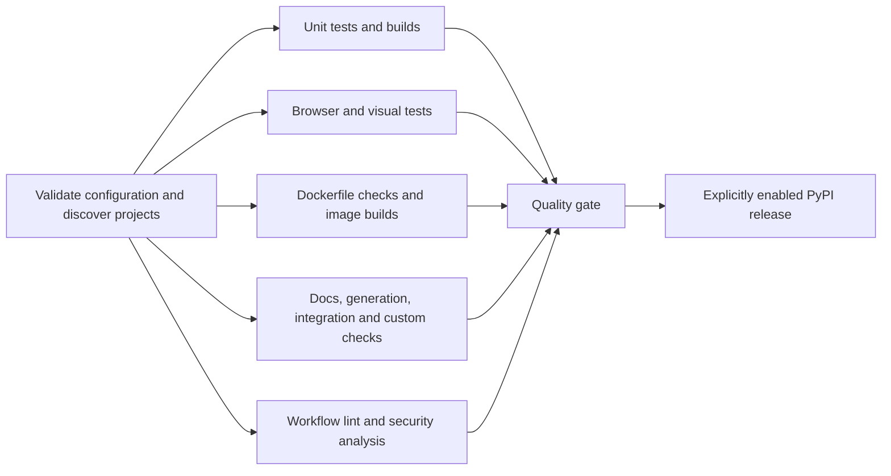

# Shared CI workflows

A central GitHub Actions quality pipeline for repositories with Python, Node.js, browser tests, Docker images, or project-owned Makefile checks. Consuming repositories pin one workflow revision; discovery selects the matching checks, and **Quality gate** fails if any required check fails, is cancelled, or is unexpectedly skipped.

## Adopt in a repository

Copy [the caller example](.github/examples/caller.yml) to `.github/workflows/ci.yml` in your repository. Replace `COMMIT_SHA` with a reviewed full 40-character commit SHA from this repository and change `main` if your default branch has another name.

```yaml
name: CI
on:
  pull_request:
  merge_group:
  push:
    branches: [main]
  workflow_dispatch:

permissions:
  contents: read

jobs:
  quality:
    uses: eslam-aboutaleb/ci-workflows/.github/workflows/ci.yml@COMMIT_SHA
    permissions:
      contents: read
      actions: read
      security-events: write
      pull-requests: read
    secrets:
      AI_EVAL_API_KEY: ${{ secrets.AI_EVAL_API_KEY }}
      PYPI_API_TOKEN: ${{ secrets.PYPI_API_TOKEN }}
```

Both keys are optional unless the matching feature is enabled. The PyPI token is required for enabled release publication. The provider key is optional. It is forwarded only to AI evaluations on default-branch pushes and manual runs against the default branch. Pull requests receive no provider key or publishing credentials. The aggregate caller needs the permissions shown because nested security and optional PyPI jobs declare those scopes; individual jobs narrow their token permissions. Container publishing is a separate opt-in call with `packages: write`.

After the first run, require the emitted **quality / Quality gate** check in your branch ruleset; use the exact name shown in GitHub. Enable required reviews, require code owner review of workflow and CI configuration changes, and include `merge_group` in callers that use a merge queue. Configure a code scanning ruleset to block the vulnerability severities you consider unacceptable: a successful CodeQL upload alone does not mean there are no findings.

Caller triggers belong to the consuming repository. The complete example also includes a weekly schedule and published releases. The central repository's triggers do not install triggers in other repositories. SHA-pinned callers adopt updates only when their pinned SHA changes. Nested workflow calls use the central workflow's revision; checkout always retrieves the consuming repository's code.



## Discovery and project configuration

The aggregate workflow accepts `config-file` (default `.github/ci.json`) and `changes-only` (default `false`). Configuration is optional. Invalid JSON or TOML, duplicate JSON keys, unknown options, conflicting lockfiles, and settings for nonexistent projects fail discovery before checks start. A job summary records the discovered and selected checks.

| Evidence in the consuming repository | Selected check |
| --- | --- |
| `pyproject.toml` | Python quality; uv when `uv.lock` exists, otherwise pip |
| `package.json` with a local npm, pnpm, or Bun lockfile | Node quality |
| A workspace package with no local lockfile | Covered by its owning workspace root; the summary lists these members |
| A standalone `package.json` without a supported lockfile | Discovery fails instead of silently omitting tests |
| `test:e2e`, `test:visual`, or `test:a11y` package scripts | Playwright/browser checks for each matching script |
| `Dockerfile`, `Dockerfile.*`, or `*.Dockerfile` | One image validation and build per Dockerfile |
| `compose.yaml`, `compose.yml`, or configured compose files | Docker Compose config validation and optional platform manifest checks |
| `*.tf` or `*.tm.hcl` | Terraform format/validation and Terramate generation drift checks |
| `ci-docs` or `ci-docs-links` Makefile targets | Documentation build/tests or link verification |
| `ci-generated` Makefile target | Regenerate files and reject drift |
| `ci-quality` Makefile target | Project-owned quality checks for any other stack |
| `ci-install`, `ci-migrate`, and `ci-integration` Makefile targets | PostgreSQL and Redis integration checks |
| `ci-eval` Makefile target | Provider evaluations on trusted default-branch push/manual runs |
| `.github/workflows/*.yml` or `*.yaml` | Actionlint in the consuming repository |
| Supported source files and Actions definitions | CodeQL language matrix; dependency review also runs on pull requests |

Node workspaces use the root's locked install and required scripts. The root scripts must test, typecheck and build all workspace members. Both `package.json` workspaces and pnpm workspace inclusion/exclusion patterns are recognized. Lockless Node projects can instead be covered by an enclosing `ci-quality` contract for package managers such as Yarn. Go, Rust, Java/Gradle/Maven, .NET, and Ruby manifests require an enclosing `ci-quality` contract because CodeQL alone does not run their unit tests.

Dependency, environment, build output, and vendored directories are excluded from discovery. This is convention-based discovery, not proof that every source file is exercised. Use project-owned contracts for stacks or layouts outside these conventions.

Start with [the fullstack configuration](.github/examples/ci.json) and keep only entries that exist in your repository. The [JSON schema](.github/ci.schema.json) supports editor validation. Project keys are normalized repository-relative paths (`.` for the root); Docker keys identify the exact Dockerfile.

```json
{
  "version": 1,
  "python": {
    "backend": {
      "python-versions": ["3.12", "3.13"],
      "coverage-source": "app",
      "coverage-min": 85,
      "pip-extras": "test"
    }
  },
  "node": {
    "frontend": {
      "node-versions": ["22", "24"],
      "operating-systems": ["ubuntu-latest", "windows-latest"]
    }
  },
  "browser": {
    "frontend": {"shards": 2, "browsers": "chromium firefox"}
  },
  "docker": {
    "backend/Dockerfile": {"build-context": "backend"},
    "frontend/Dockerfile": {"build-context": "frontend"}
  }
}
```

Python configuration supports version/OS arrays, `test-path`, `pip-extras`, `pip-constraints`, `coverage-source`, `coverage-min`, `build-distribution`, and `publish-pypi`. Distribution checks default to enabled only when a `[build-system]` table exists. Publishing defaults to disabled. Set both coverage fields to enforce a threshold; unset coverage fields provide no coverage threshold.

Node configuration supports version/OS arrays, `test-shards`, `pnpm-version`, `bun-version`, and `audit-level`. Browser configuration supports `test-script`, `node-version`, package manager versions, `browsers`, and `shards`. Docker configuration supports `build-context`, `platforms`, `target`, and a `build-args` array of non-secret `KEY=value` strings. Contexts default to the repository root; configure backend/frontend contexts explicitly when their `COPY` paths require them. Each Dockerfile builds its final stage unless `target` selects another stage; unused stages are not independently built.

### Optional change filtering

To reduce monorepo CI cost, set `changes-only: true` on the aggregate call and define `paths` globs for selected Python, Node, browser, Docker, or custom-contract entries. Include every shared dependency path used by those projects. Entries without `paths` always run. Security and workflow lint always run when applicable. Configuration/workflow changes and changes to root files invalidate filtering for all projects. Failed diff detection falls back to a full run. Pushes, releases, schedules, merge queues, and manual runs always run the full selected suite.

Filtering is off by default because the pipeline cannot infer your dependency graph. The final gate still runs when no changed project needs a matrix job.

## Workflow contracts

Every shared workflow is callable individually through `workflow_call`. Callers must supply the required inputs and permissions; definitions under `on.workflow_call.inputs` are the authoritative reference.

| Workflow | Required inputs | Behavior |
| --- | --- | --- |
| [ci.yml](.github/workflows/ci.yml) | None | Discovery, selected checks, summaries, stable final gate |
| [python.yml](.github/workflows/python.yml) | `project-dir`, `manager` (`uv`/`pip`) | Ruff lint/format, pytest on each Python/OS combination, optional coverage threshold and distributions; JUnit/coverage artifacts |
| [node.yml](.github/workflows/node.yml) | `project-dir`, `manager` (`npm`/`pnpm`/`bun`) | Frozen install, dependency audit, mandatory lint/typecheck/test/build; optional OS and shard matrices; available test/coverage artifacts |
| [browser.yml](.github/workflows/browser.yml) | `project-dir`, `manager` | Locked Playwright install, browser or visual script, shards, available reports/traces/screenshots |
| [docker.yml](.github/workflows/docker.yml) | None | Dockerfile build checks and image builds, optional stages/platforms/arguments, scoped BuildKit cache; no registry credentials |
| [compose.yml](.github/workflows/compose.yml) | None | Docker Compose configuration validation and optional multi-arch image manifest verification |
| [terraform.yml](.github/workflows/terraform.yml) | `project-dir` | Terraform format/validate across modules and stacks, plus Terramate format and generation drift checks |
| [project-check.yml](.github/workflows/project-check.yml) | `project-dir`, `target` | Run `ci-install`, then the chosen Make target; optional generated-file drift check |
| [integration.yml](.github/workflows/integration.yml) | `project-dir` | Healthy PostgreSQL/Redis services, install, migrate, integration tests |
| [ai-eval.yml](.github/workflows/ai-eval.yml) | `project-dir` | Install Python/Node/uv tooling, run `ci-eval`; optional named provider key |
| [security.yml](.github/workflows/security.yml) | None | CodeQL, compiled-language builds, Gitleaks secret scan, optional caller-owned configuration, dependency review on PRs |
| [workflow-lint.yml](.github/workflows/workflow-lint.yml) | None | Actionlint against the consuming repository's workflows |
| [publish-docker.yml](.github/workflows/publish-docker.yml) | `image` | Event validation, image build validation, approved GHCR publication, provenance, SBOM and digest output |
| [publish-pypi.yml](.github/workflows/publish-pypi.yml) | `project-dir`, `distribution-name` | Match release tag to package metadata, build/check distributions, approved publication using `PYPI_API_TOKEN` |
| [validate.yml](.github/workflows/validate.yml) | Repository maintenance only | Actionlint, shared contract checks, discovery and gate regression tests |
| [propagate.yml](.github/workflows/propagate.yml) | Repository maintenance only | Automatically open PRs updating pinned `ci-workflows` SHAs across downstream repositories listed in `.github/downstream.json` |

Python uv projects must lock Ruff, pytest and pytest-cov when coverage is enabled. pip projects use an editable install; install test extras or provide a constraints file as appropriate. Node projects must define noninteractive `lint`, `typecheck`, `test`, and `build` scripts. Audits fail at `high` by default; use `moderate` for a stricter threshold. Bun must have an exact runtime version in `packageManager: bun@<version>` or `bun-version`. pnpm uses `packageManager` or an explicit `pnpm-version`.

`operating-systems` accepts `ubuntu-latest`, `windows-latest`, and `macos-latest`; defaults remain Linux. Node `test-shards` defaults to one. When greater than one, the project's `test` script must actually partition tests using `CI_SHARD_INDEX` and `CI_SHARD_TOTAL`. Lint, typecheck, audit, and build run once per Node/OS combination; all test shards must pass.

Browser scripts must use a declared local Playwright dependency. Their configuration must start the application and services and select the browser projects to test. `browsers` controls installed binaries; the Playwright configuration controls which projects execute. `shards > 1` forwards `--shard=index/total` to the script. Visual checks compare reviewed baselines; CI does not update or commit snapshots. Available `playwright-report`, `test-results`, and `blob-report` directories are retained for seven days, including on failure. Python/Node reports are retained for seven days when produced.

### Documentation, generation, and other stacks

Provide a Makefile with explicit targets. `ci-install` installs project tooling and dependencies with your lockfile. Each check gets a clean checkout and an independent installation.

```makefile
.PHONY: ci-install ci-docs ci-docs-links ci-generated ci-quality

ci-install:
	npm ci

ci-docs:
	npm run docs:build
	npm run docs:test

ci-docs-links:
	npm run docs:links

ci-generated:
	npm run generate

ci-quality:
	npm run lint
	npm run typecheck
	npm test
	npm run build
```

For another stack, make `ci-install` install its pinned toolchain/dependencies and make `ci-quality` run its formatter, linter, type checks, unit tests, audit, and build as appropriate. `project-check.yml` provides Python, Node and uv. Optional `pnpm-version` and `bun-version` inputs install those tools. Project-specific Java, Rust, Go, .NET or other toolchains belong in `ci-install`.

Generation fails on modified/deleted tracked files, staged changes, or newly created unignored files anywhere in the checkout. Commit generated sources and ignore transient build outputs. `contracts` configuration can add custom `ci-*` targets, set runtime versions or paths, and label them `quality`, `docs`, or `generated`. Generated contracts always enforce drift checking.

```json
{
  "version": 1,
  "contracts": [
    {"kind": "docs", "project-dir": "docs", "target": "ci-docs", "pnpm-version": "10.10.0"},
    {"kind": "generated", "project-dir": ".", "target": "ci-generated"},
    {"kind": "quality", "project-dir": "agent", "target": "ci-eval-offline"}
  ],
  "security": {
    "config-file": ".github/codeql-config.yml",
    "build-command": "make ci-codeql"
  }
}
```

Provider AI evaluations run on trusted default-branch pushes/manual runs and receive only `AI_EVAL_API_KEY`, mapped to the evaluation step. `ci-eval` installs and runs the suite and must return nonzero when scores violate project thresholds. Use an additional secret-free quality contract, such as `ci-eval-offline`, for PR evaluations. The central workflow cannot choose datasets or meaningful evaluation thresholds for each application.

Integration targets receive `CI_POSTGRES_URL` and `CI_REDIS_URL` for disposable services. Individually called integration workflows accept `postgres-image` and `redis-image`; defaults are `postgres:16` and `redis:7`. PostgreSQL extensions may require a compatible image, for example pgvector.

CodeQL keeps the `security-extended` suite. Its optional `config-file` is resolved inside the consuming repository. Compiled C/C++, C#, Go, Java/Kotlin and Swift use autobuild or the configured `build-command`; Swift runs on macOS. Rust uses analysis without a build. Multi-language custom build commands must prepare every compiled language they cover. Source analysis complements the project's unit-test/build contract. Dependency review and CodeQL require the corresponding GitHub security features and licensing; unavailable features fail their selected jobs.

## Publishing

Verification and publishing have separate permissions and environments. Configure required reviewers and deployment branch/tag restrictions before enabling a `pypi` or `containers` environment. Creating an environment in YAML does not configure its protection rules.

To enable aggregate PyPI publication, set `"publish-pypi": true` for the intended Python project and include `release: types: [published]` in the caller. Final releases publish only after Quality gate passes, and only if the tag is exactly `v<project.version>`. Store a PyPI API token authorized for the target distribution as the consuming repository's `PYPI_API_TOKEN` Actions secret, pass it explicitly to the workflow, and configure required reviewers on the `pypi` environment. The token reaches only the approved upload job. PyPI OIDC publication requires an upload job in the consuming repository's own workflow; it is not supported from a called workflow. Token publication does not generate PyPI attestations. In monorepos, enable only packages intended to share that release tag, or use separate direct publication jobs.

Container publication is an explicit separate job after the aggregate caller completes successfully:

```yaml
  publish-container:
    needs: quality
    if: github.event_name == 'release' && github.event.action == 'published' && !github.event.release.prerelease
    uses: eslam-aboutaleb/ci-workflows/.github/workflows/publish-docker.yml@COMMIT_SHA
    permissions:
      contents: read
      packages: write
    with:
      image: ghcr.io/your-owner/your-image
      dockerfile: backend/Dockerfile
      build-context: backend
      platforms: linux/amd64,linux/arm64
```

`image` must be lowercase and owned by the consuming repository's owner. The workflow accepts final published releases or pushes/manual runs on a protected default branch. It uses the `containers` environment, pushes a full commit SHA tag plus the release tag when applicable, generates provenance and an SBOM, and returns `digest` for deployment by immutable digest. Grant the repository write access to an existing GHCR package when needed. No `latest` tag is created. Publication rebuilds the validated source; pin base images by digest when reproducibility is required. Neither Docker builds nor SBOM generation provide a container vulnerability scan or runtime smoke test; add those to your project contract where required.

## Maintaining the central repository

External actions use full commit SHAs. Dependabot proposes action updates weekly; review their runtime, input and permission changes before merging. The workflows use Node 24 compatible actions and require a compatible GitHub hosted runner; the actions' baseline is runner v2.327.1 or later. Artifact actions v7/v8 are not supported on GitHub Enterprise Server, so this suite targets GitHub.com.

`CODEOWNERS` assigns this repository's workflow/configuration reviews to its maintainer. Consuming repositories need their own ownership rules. The PR template records caller compatibility and validation evidence.

Run the repository's maintenance checks locally with Python, PyYAML, Go and actionlint available:

```sh
python3 -m pip install -r .github/requirements-ci.txt
python3 .github/scripts/check_workflows.py
python3 -m unittest discover -s .github/scripts -p 'test_*.py' -v
actionlint -color .github/workflows/*.yml
```

The regression suite exercises discovery on temporary fullstack/workspace repositories, invalid configurations, change filtering, and required-check failures. Workflow syntax and fixture tests do not replace a real GitHub Actions run against a representative consuming repository. Review the selected-check summary, enable the ruleset, and update consuming SHA pins deliberately.
